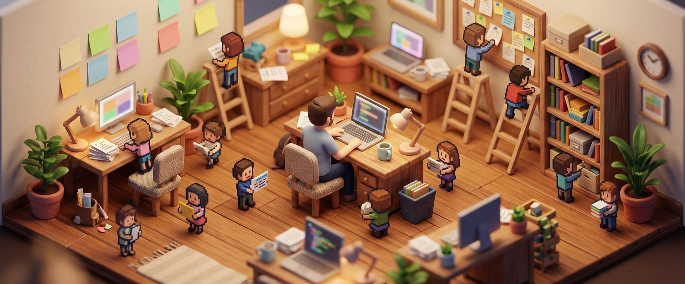
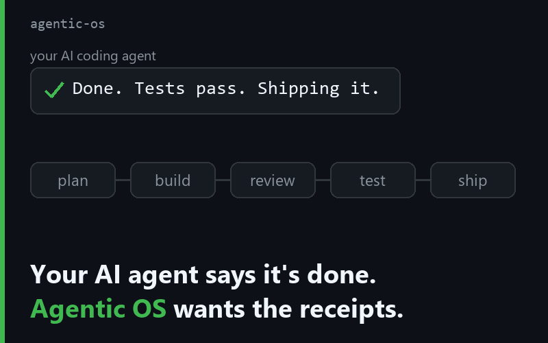
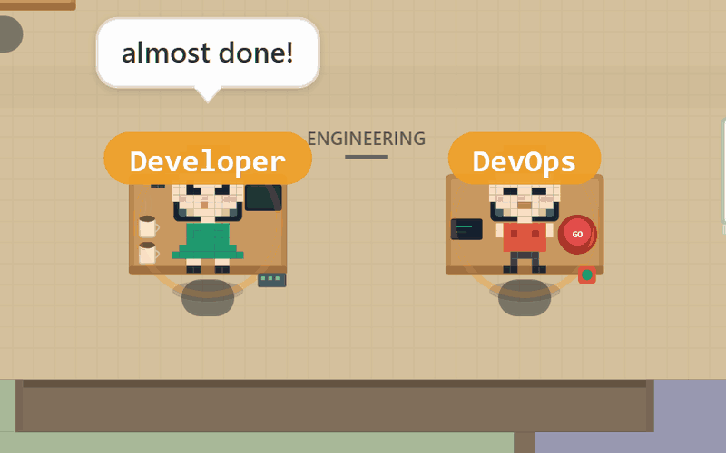
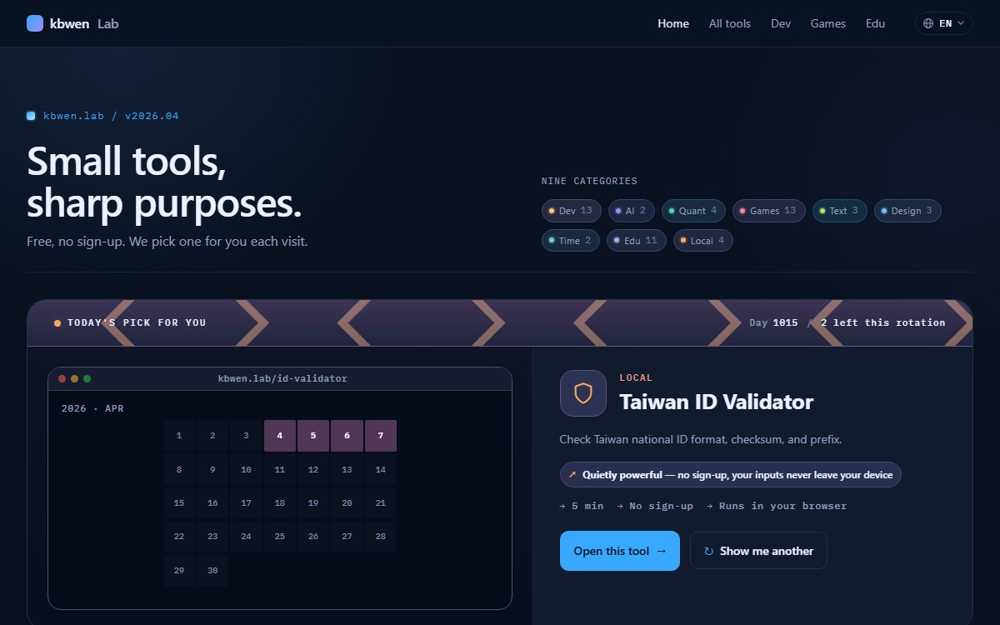
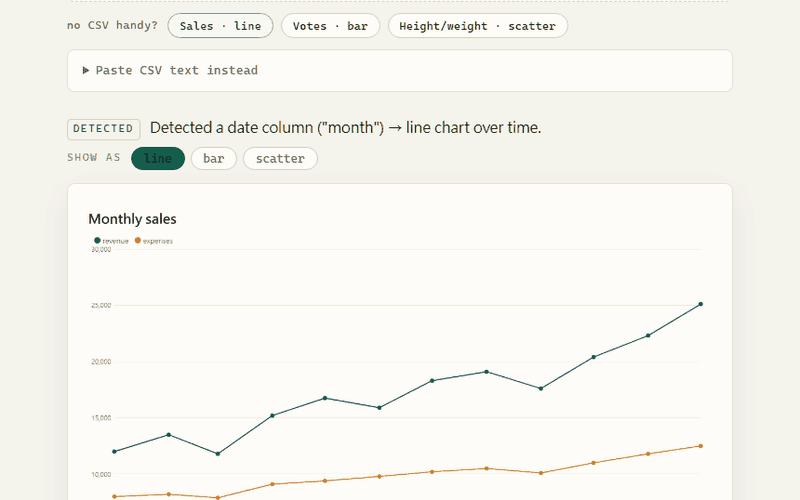
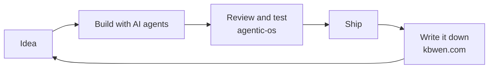
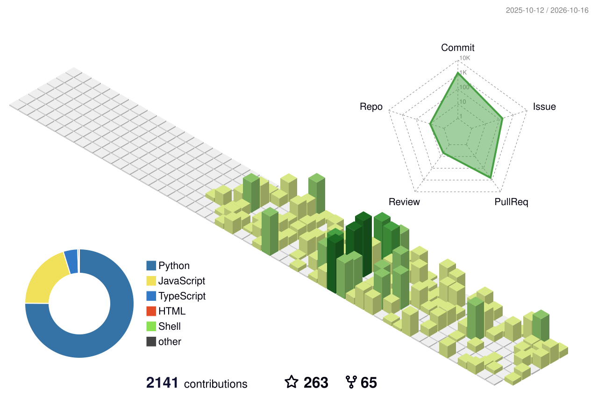

<picture>
  <source media="(prefers-color-scheme: dark)" srcset="assets/hero-night.jpg">
  
</picture>

# Ian Wen

I build tools, games, and apps in Taiwan, with AI as an everyday coworker.
先做出來，再順手記下來。

## What I'm building

<table>
<tr>
<td width="50%" valign="top">
 
<b><a href="https://github.com/KbWen/agentic-os">agentic-os</a></b> 
A plan → build → review → test → ship workflow for AI coding agents.
</td>
<td width="50%" valign="top">
 
<b><a href="https://github.com/KbWen/agent-virtual-office">agent-virtual-office</a></b> 
Watch your AI coding agents at work in a live pixel office.
</td>
</tr>
<tr>
<td width="50%" valign="top">
 
<b><a href="https://lab.kbwen.com">Lab</a></b> 
Browser tools and small games. No signup, and more keep coming.
</td>
<td width="50%" valign="top">
 
<b><a href="https://github.com/KbWen/chartsnap">chartsnap</a></b> 
CSV to chart in your browser, sized for social or print.
</td>
</tr>
</table>

**Also:** [agent-field-notes](https://github.com/KbWen/agent-field-notes) — real AI coding incidents, each with a guardrail ·
[security-tools](https://github.com/KbWen/security-tools) — scans for leaked secrets, IaC and LLM / MCP risks ·
[living-world](https://github.com/KbWen/living-world) — a tiny voxel city that grows from AI coding sessions ·
[smart-stock](https://github.com/KbWen/smart-stock) — an honest little Taiwan-stock toy, no hot tips

## How I build

## Lately

<picture>
  <source media="(prefers-color-scheme: dark)" srcset="profile-3d-contrib/profile-night-green.svg">
  
</picture>

<table>
<tr>
<td width="50%" valign="top">

**Latest releases**

<!-- recent_releases starts -->
- [agent-virtual-office v1.6.14](https://github.com/KbWen/agent-virtual-office/releases/tag/v1.6.14) — 2026-10-29
- [agentic-os v1.8.36](https://github.com/KbWen/agentic-os/releases/tag/v1.8.36) — 2026-10-29
- [agent-virtual-office v1.6.13](https://github.com/KbWen/agent-virtual-office/releases/tag/v1.6.13) — 2026-10-24
- [agent-virtual-office v1.6.12](https://github.com/KbWen/agent-virtual-office/releases/tag/v1.6.12) — 2026-10-21
- [security-tools v1.2.14](https://github.com/KbWen/security-tools/releases/tag/v1.2.14) — 2026-10-21
<!-- recent_releases ends -->

</td>
<td width="50%" valign="top">

**Latest notes**

<!-- recent_posts starts -->
- [Copying nested lists in Python](https://www.kbwen.com/python-nested-list-copy-en/) — 2026-10-27
- [Python 淺拷貝與巢狀串列](https://www.kbwen.com/python-shallow-copy-nested-list/) — 2026-10-27
- [RAG 混合檢索的 Reciprocal Rank Fusion](https://www.kbwen.com/rag-reciprocal-rank-fusion-zh/) — 2026-10-27
- [Reciprocal rank fusion with multiple vector fields](https://www.kbwen.com/rag-reciprocal-rank-fusion-en/) — 2026-10-27
- [DeepSeek-V3's auxiliary-loss-free load balancing and multi-token prediction](https://www.kbwen.com/deepseek-v3-moe-architecture-efficiency/) — 2026-10-20
<!-- recent_posts ends -->

</td>
</tr>
</table>

<picture>
  <source media="(prefers-color-scheme: dark)" srcset="https://api.star-history.com/svg?repos=KbWen/agentic-os%2CKbWen/agent-virtual-office&type=Date&theme=dark">
  
</picture>

## What's next

More small products, AI built into them, and open source wherever it can be.

[kbwen.com](https://kbwen.com) · [Lab](https://lab.kbwen.com) · 
